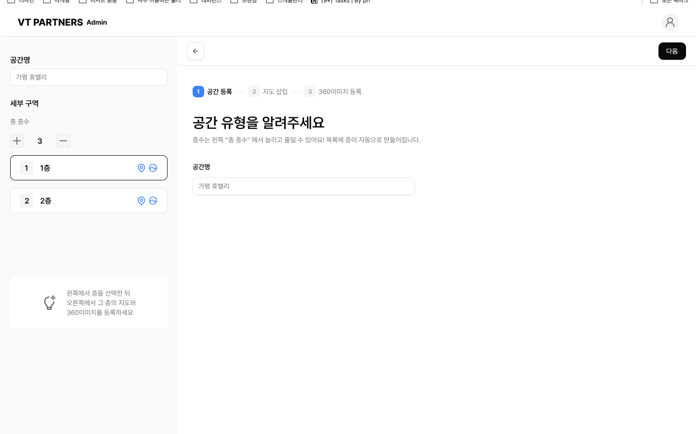
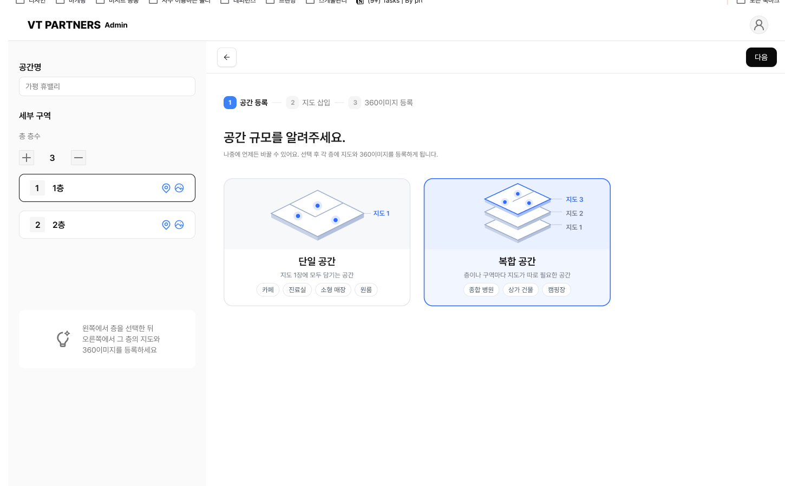

# 공간 등록 플로우 개선 시안

VT PARTNERS Admin의 **공간 등록(미니맵 + 층 구분)** 플로우를 UX 법칙(제이콥·힉·피츠·점진적 공개·밀러)과 WCAG 2.1 AA 기준으로 리뷰하고, 개선안을 동작하는 HTML 프로토타입으로 만들었습니다.

- 리뷰 대상: Figma 시안 `460:1532` (공간 유형 / 공간 규모 화면 2종), 운영 중인 `vtpartners.co/space`, `/space-create`, `/space/:id` (읽기만 함, 데이터 변경 없음)
- 프로토타입: **https://seundyuu.github.io/space-registration-redesign/** (소스: [`index.html`](index.html), 빌드 없음)

```bash
python3 -m http.server 5173
```

| 현재 Figma 시안 (1) | 현재 Figma 시안 (2) |
|---|---|
|  |  |

## 디자인 시스템 기준

프로토타입은 **Figma 시안(460:1532)의 변수·컴포넌트를 그대로** 사용하고, 시안에 없는 컴포넌트만 **shadcn/ui** 스펙을 따랐습니다.

| 출처 | 사용한 것 |
|---|---|
| Figma 변수 | Pretendard Variable, `foreground #0a0a0a` · `primary #171717` · `muted-foreground #737373` · `secondary #f5f5f5` · `border #e5e5e5` · `sidebar #fafafa`, radius 2/8/10, 텍스트 스타일(3xl·base·sm·xs) |
| Figma 컴포넌트 | Navigation(로고·아바타), Sidebar, Navigation/GNB, StepForm 스테퍼, Title, Select(입력), Buttons, ItemOrder(지도 목록), tip, Space Type Card(일러스트 SVG 원본), lucide/remix/tabler 아이콘 |
| shadcn/ui | Tabs, Card, Badge(default/outline), Table, AlertDialog, Checkbox, RadioGroup, Sonner(토스트), Progress |

접근성을 위해 시안 값에서 바꾼 부분:
- 입력란 테두리 `#e5e5e5 → #8f8f8f`(`--input` 토큰 추가, 1.4.11 비텍스트 대비 3:1)
- 스테퍼 활성 배지 `chart-2 #3b82f6 → #2f6bff`(흰 숫자 대비 3.7:1 → 4.5:1, 카드 선택색과 통일)
- 비활성 스테퍼 숫자 `semantic-border #a3a3a3 → muted-foreground`(2.5:1 → 4.7:1)
- 층수 조절 버튼 28px → 36px, 순서 `+ n −` → `− n +`
- ItemOrder의 지도·360 아이콘 옆에 상태 텍스트(`지도`/`지도 없음`, `3/6`) 추가
- Space Type Card 선택 시 `✓ 선택됨` 배지 추가(색 외 구분)

---

## 🟢 잘된 점

| 법칙 | 근거 |
|---|---|
| **제이콥의 법칙** | 좌측 구조 패널 + 우측 작업 영역 + 상단 스테퍼는 Notion·Figma·쇼핑몰 어드민에서 익숙한 패턴. 학습 비용이 낮음. |
| **힉의 법칙** | 공간 규모를 `단일 / 복합` **2지선다**로 압축. 각 카드에 `카페·진료실`, `종합 병원·캠핑장` 같은 예시 칩이 있어 추상적인 "규모"를 구체 사례로 판단하게 해 줌. |
| **점진적 공개** | 운영 화면(`/space-create`)이 "몇 층인가요?" 한 질문으로 시작하는 것, 3단계 스테퍼(공간 등록 → 지도 삽입 → 360 등록)로 큰 작업을 쪼갠 것은 좋은 출발점. |
| **밀러의 법칙** | 스테퍼 3단계, 선택지 2개, 층 카드 단위 그룹핑 — 작업 기억 범위 안에 있음. |
| **시각적 은유** | 단일=평면 1장, 복합=적층 평면 일러스트가 개념을 즉시 전달. 아이소메트릭 지도 위에 핀이 찍힌 모습이 "미니맵"이라는 결과물을 미리 보여 줌. |
| **접근성(운영)** | `/space/:id`의 체크박스·삭제 버튼에 `입구 선택`, `입구 삭제`처럼 대상별 접근 가능한 이름이 붙어 있음. 공개 스위치도 `role=switch` + 이름 있음. |

## 🔴 개선점

### 1. 점진적 공개 위배 — 결정 전에 결과가 먼저 보임
- 1단계에서 아직 `단일/복합`을 고르지 않았는데 **좌측에 층 목록(1층·2층)과 층수 조절기가 이미 노출**됨. 사용자는 "층을 먼저 정해야 하나?"라고 오해하고, 화면에 두 개의 작업 축(좌: 층, 우: 규모)이 동시에 생김 → 인지 과부하.
- 하단의 💡 안내("왼쪽에서 층을 선택한 뒤 오른쪽에서…")는 **아직 할 수 없는 3단계 행동**을 1단계에서 설명함.

### 2. 데이터 불일치 — 신뢰 저하
- 좌측 "총 층수 **3**"인데 목록에는 **1층·2층 두 개**만 있음. 숫자와 목록이 따로 놀면 사용자는 둘 중 무엇이 진실인지 확인하는 데 작업 기억을 씀.
- `공간명`이 좌측 패널과 본문 두 곳에 **중복 입력란**으로 존재. 어디에 쓰면 저장되는지 불명확.
- 시안 1의 제목은 "공간 **유형**을 알려주세요"인데 입력 필드는 `공간명`. 제목과 과업이 불일치.

### 3. 제이콥의 법칙 위배 — 층수 조절기 순서
- `[+] 3 [−]` 순서. 거의 모든 수량 조절기(장바구니, iOS Stepper, 각종 디자인 시스템)는 **`[−] 3 [+]`**. 습관대로 왼쪽을 누르면 반대로 동작함.

### 4. 피츠의 법칙 위배 — 주 행동 버튼이 멀고 작음
- `다음` 버튼이 우측 **상단 모서리**의 작은 버튼(약 56×36px). 사용자의 시선·커서는 본문 하단(카드 선택 지점)에 있는데 주 행동은 반대편 끝에 있음.
- 층 카드의 지도/360 아이콘(📍, 🌐)은 약 18px로, 터치 기준(44×44px)과 WCAG 2.5.5 권장 크기에 못 미침.
- 운영 `/space`의 카드 hover 메뉴에서 **`공간 설정` 바로 옆에 `공간 삭제`**가 동일 크기로 배치 → 잘못 누를 확률이 높음(피츠의 법칙이 역으로 작용).

### 5. 밀러의 법칙 위배 — 360 이미지가 한 덩어리
- 운영 `/space/5`(가평 휴밸리)는 **360 이미지 48장이 한 그리드**에 평평하게 나열됨. 어떤 이미지가 지도에 배치됐는지, 어느 구역인지 구분 정보가 없어 스캔 비용이 큼.

### 6. 상태 표현이 아이콘·색상에만 의존
- 층 카드의 📍/🌐 아이콘은 "등록됨"인지 "등록하러 가기"인지 의미가 모호하고 **텍스트 레이블이 없음**. 완료/미완료 구분도 없음.

### 7. WCAG 2.1 AA 체크

| 항목 | 현재 | 판정 |
|---|---|---|
| **명도 대비 (1.4.3)** | 보조 문구(`층수는 왼쪽 "총 층수"에서…`, 카드 설명, 스테퍼 비활성 단계)가 연회색 #999 계열 추정 → 흰 배경에서 약 2.8:1. `공간명` 입력값 "가평 휴밸리"가 **플레이스홀더처럼 회색**이라 입력됐는지 판단이 어려움. | ❌ |
| **비텍스트 대비 (1.4.11)** | 입력란·카드 테두리가 #E5E7EB 수준 → 약 1.3:1 (기준 3:1). 선택된 카드는 연파랑 배경+파란 테두리로 **색상 차이만으로** 구분. | ❌ |
| **차트·지도 (1.4.1 색상 사용)** | 미니맵 핀이 모두 같은 파란 점, 레이블 없음. 어떤 점이 어떤 360 이미지인지 알 수 없음. | ❌ |
| **키보드 (2.1.1 / 2.4.7)** | 운영 `/space-create`의 `단일 층 / 2층 이상` 카드는 **이름 없는 `<button>`** 두 개(스크린리더: "버튼, 버튼"). 규모 선택이 라디오 그룹이 아니어서 화살표 키 탐색·선택 상태 낭독 불가. `/space`의 `새 공간 추가` 링크도 접근 가능한 이름 없음. | ❌ |
| **모달 (2.1.2 / 2.4.3)** | 삭제 확인 등 모달의 포커스 트랩·Esc·포커스 복귀 정의 없음(시안에 미정의). | ⚠️ 정의 필요 |
| **테이블 (1.3.1)** | 층별 진행 현황을 한눈에 보는 표가 없음. 생긴다면 `<caption>`, `th scope` 필요. | ⚠️ 정의 필요 |
| **오류 식별 (3.3.1)** | 필수값 누락 시 `다음`이 어떻게 반응하는지 정의 없음. | ⚠️ 정의 필요 |

---

## 🛠️ 구체적 액션 플랜 (프로토타입에 반영됨)

### A. 플로우 재구성 — 3단계, "지도"를 단위로
```
① 공간 정보   →   ② 지도 추가하기          →   ③ 확인하기
   이름+크기        왼쪽 목록에서 지도 추가·선택       표+차트, 공개 설정
                    오른쪽에서 이름·지도·360 채우기
```
- **단위는 '층'이 아니라 '지도'**: 방문자 화면에서는 층이든 구역이든 똑같이 미니맵 한 장으로 보이고, `1층`·`캠핑 사이트` 같은 이름은 관리자가 붙이는 라벨이다. 그래서 층/구역을 미리 정하게 하지 않고 지도를 필요한 만큼 추가한다. Figma 카드의 `지도 1 · 지도 2 · 지도 3` 표기와도 이어진다.
- **② 지도 추가하기**: 처음엔 지도 1장. 왼쪽 `+ 지도 추가`로 늘리고, 오른쪽 지도 패널 **제목 자리에서 바로 이름을 붙이고**(인라인 편집, 비어 있으면 점선 입력칸) 지도 이미지 → 360이미지·위치 찍기 순서로 채운다. 이름은 방문자 화면의 미니맵 이름과 같은 자리·같은 값이라 따로 입력 칸을 두지 않았다. ↑↓로 방문자에게 보이는 순서를 바꾸고, 지도 삭제는 확인 창을 거친다. 이름이 비어 있으면 다음으로 넘어갈 때 해당 지도로 이동해 이름을 요청한다.
- **지도 만드는 방식**: 편집 모드의 '지도 추가' 모달과 같은 두 가지를 등록 단계에서 바로 고른다.
  - **네이버 지도(권장)**: 360이미지의 GPS 위치로 실제 지도를 불러오고, GPS가 있는 사진은 위치가 자동으로 찍힌다(`✓ GPS로 찍힘`). GPS가 없는 사진만 직접 찍는다. 캠핑장처럼 야외에 넓게 퍼진 곳에 맞다.
  - **직접 업로드**: 평면도·안내도 이미지를 올리고 사진 위치를 직접 찍는다. 건물 안·층별 공간에 맞다.
  - 지도마다 방식을 따로 고를 수 있다(예: 캠핑장=네이버 지도, 본관 1층=직접 업로드). 구역 그리기는 편집 모드에서.
- **단일 공간**은 이름 입력 없이 지도 1장만 채운다. `+ 지도 추가`를 누르면 자연스럽게 복합 공간으로 바뀐다.
- **③ 확인하기**: 지도별 현황 표 + 배치율 막대. 기본값은 **나만 보기**(실수로 공개되는 것 방지), 다 못 채운 지도가 있어도 저장 후 이어서 작업 가능.

### B. 좌측 레일 = 지도 목록 (②부터 노출)
- 공간 이름은 **읽기 전용 표시**만 (입력은 ①에서 한 번).
- 지도마다 이름, `지도`/`지도 없음`, `위치 찍은 사진 3/6`을 **아이콘+텍스트**로 표시. 누르면 그 지도로 이동. 이름이 비어 있으면 `이름 없음`으로 표시.
- 상단 `지도 3장 · 3장 중 1장 완료` 요약, 하단 `+ 지도 추가`.

### C. 하단 고정 액션바 (피츠의 법칙)
- `이전`(좌) — 상태 메시지(중앙) — **`다음` 160×48px**(우), 화면 하단 고정.
- ③에서는 `다음: 2층`처럼 **다음 목적지를 버튼에 명시**.
- 필수값이 비어 있으면 `aria-disabled` + 사유 문구("공간명·공간 규모를 입력하면 다음으로 갈 수 있어요"). 눌러도 무시하지 않고 **첫 오류 필드로 포커스 이동 + 인라인 오류**.

### D. 미니맵 핀 배치 UX
- 이미지 카드 `위치 지정` → 지도 클릭 → 핀 생성 → **다음 미배치 이미지가 자동 선택**(연속 작업 시 클릭 수 절반).
- 핀은 **번호 + 이름 레이블**로 직접 표기, 이미지 카드에도 같은 번호. 우측에 `배치 현황 2/6` 목록 텍스트 대체.
- 키보드: 지도에 포커스 후 `Enter`로 중앙 배치(이후 드래그 조정 — 실서비스 시 방향키 미세 이동 권장).
- 이미지가 6장을 넘으면 `1–6번`, `7–12번` 그룹 헤더로 청킹(실서비스에선 "구역"/"동선" 그룹 권장).

### E. 접근성 구현 디테일

| 요구사항 | 구현 |
|---|---|
| 차트 접근성 | 배치됨=**단색**, 미배치=**빗금 패턴**. 막대 옆에 `3/6 배치` 직접 레이블. 같은 데이터를 표로도 제공. |
| 명도 대비 | 본문 #111827(17.7:1), 보조 #4B5563(7.6:1), Primary #1D4ED8(6.7:1), 경고 #92400E(7.1:1). 테두리 #6B7280(4.8:1). 다크 모드 토큰도 동일 기준. |
| 키보드 | 규모 선택 = 네이티브 `radio` (←→ 이동), 층 탭 = `role=tablist` + 로빙 tabindex(←→/Home/End), 모든 포커스에 3px 주황 링, `본문으로 건너뛰기` 링크, 단계 전환 시 `h1`로 포커스 이동. |
| 모달 | 네이티브 `<dialog>.showModal()` → 포커스 트랩·Esc 닫기 기본 제공. 열릴 때 **안전한 `취소`에 초기 포커스**, 닫히면 원래 삭제 버튼으로 포커스 복귀. |
| 테이블 | `<caption>지도별로 채운 내용</caption>`, 열 머리 `th scope="col"`, 각 행의 지도 이름 `th scope="row"`, 숫자 열 우측 정렬·tabular-nums, 행별 `1층 수정` 버튼. |
| 상태 알림 | 토스트 `role=status`, 액션바 메시지 `aria-live=polite`, 스테퍼 `aria-current="step"` + "(완료)" 스크린리더 텍스트. |
| 터치 타깃 | 모든 버튼 최소 44px 높이. 삭제 버튼은 주 행동과 분리된 위치 + 확인 모달. |

### F. 운영 화면에 바로 적용할 수 있는 빠른 수정 (Quick wins)
1. `/space-create`의 두 카드 버튼에 접근 가능한 이름 추가 → `<button aria-label="단일 층 공간으로 만들기">` 또는 라디오 그룹으로 교체.
2. `/space`의 `새 공간 추가` 링크에 텍스트/`aria-label` 추가.
3. `/space` 카드 hover 메뉴에서 `공간 삭제`를 `⋯` 더보기 메뉴 안쪽으로 이동하고 빨간 텍스트 + 확인 모달.
4. `/space/:id`의 48장 그리드에 `지도 배치됨/미배치` 필터와 구역 그룹 헤더 추가.
5. 층수 조절기 `[−] n [+]` 순서로 교체, 층수와 목록 동기화 버그 수정.

---

## UX 라이팅 (토스 원칙 적용)

화면 문구는 토스 UX 라이팅 원칙에 맞춰 다시 썼습니다.
- **해요체로 통일**: `정하면 됩니다` → `정하면 돼요`
- **덜어내기**: 한 문장에 한 가지만. `→` 같은 기호로 단계를 나열하지 않기
- **쉬운 말**: `미배치` → `위치 없음`, `위치 지정` → `위치 찍기`, `지도 교체` → `지도 바꾸기`, `규모` → `크기`, `비공개로 저장` → `나만 보기`
- **강요 대신 제안**: `등록하세요` → `올려주세요`, 제목은 질문형(`어떤 공간을 만들까요?`, `이대로 만들까요?`)
- **해결책을 주는 오류 문구**: `공간명을 입력해 주세요` → `공간 이름을 알려주세요`, 막힌 이유는 하단 바에 한 줄로
- **사용자 상황 말하기**: `미완료 2개` → `아직 다 못 채운 지도가 2장 있어요. 나만 보기로 만들고 이어서 채워도 돼요.`, 지도 이름 안내 `방문자 화면에서 미니맵 이름으로 보여요.`

## 다음 단계 제안
- 프로토타입의 플로우를 Figma 시안에 반영(① 화면에서 좌측 레일 제거, 하단 액션바 추가)
- 실제 사용자 3~5명에게 "3층 상가 건물 등록" 과업으로 사용성 테스트 → 단계별 소요 시간·이탈 지점 측정
- 360 이미지 그룹 기준(층 > 구역 > 동선) 정의
